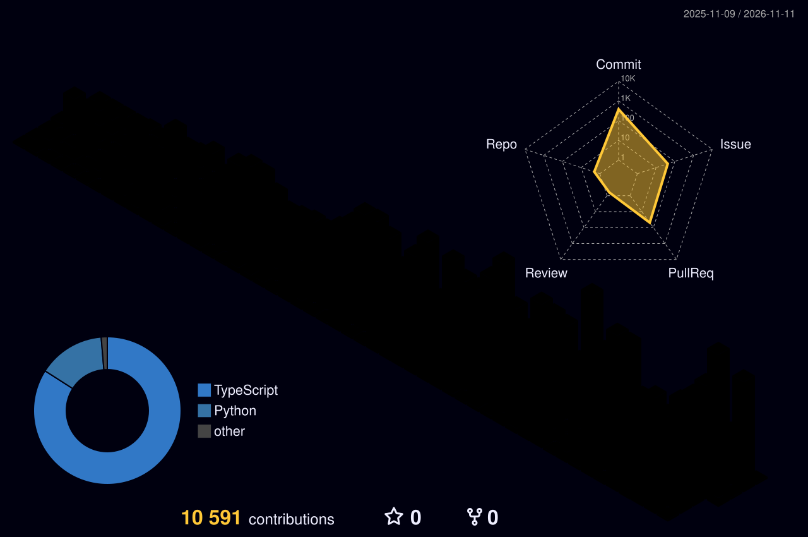

<p align="center">
  
</p>

<p align="center">
  
</p>

<p align="center">
  
  
  
  
</p>

---

### 💻 `~/raj $ whoami`

```bash
$ whoami
> raj. full-stack dev. part-time menace. full-time "one more feature".

$ cat /proc/raj/stats
  rizz with recruiters   ████████░░  80%
  aura                   ██████████  100%   (no cap)
  chai consumed          ██████████  overflow error
  sleep schedule         █░░░░░░░░░  10%    (it's cooked)
  touching grass         ░░░░░░░░░░  0%     (side quest, pending)
```

### 📜 patch notes — `raj v2.6`

```diff
+ added    AI to literally everything (it's not a phase, mom)
+ added    dark mode to my entire personality
+ buffed   debugging speed by +40% when someone is watching
- removed  sleep
- removed  fear of deploying on fridays
- nerfed   patience for "can we hop on a quick call?"
! known issue: says "5 min fix", takes 5 hours
! known issue: will rewrite your whole codebase "just to clean it up"
```

### 🚩 flags check

| 🟢 green flags | 🚩 red flags |
|:--|:--|
| writes tests (sometimes) 🧪 | `console.log("here")` x47 |
| dark mode everything 🌚 | 37 tabs open, all "important" |
| ships fast, fixes faster ⚡ | names variables `thing2_final_v3` |
| answers PR reviews ✅ | "works on my machine" 🤷 |

### 🎯 current side quests

- [x] make the code work
- [x] make the code fast
- [ ] understand why it works
- [ ] fix the sleep schedule (skill issue)
- [ ] touch grass 🌱

### 🛠️ the arsenal

<p align="center">
  
</p>

### 🏙️ the grind, but make it 3D

<p align="center">
  
</p>

<p align="center">
  
</p>

<p align="center">
  
  <br/><sub>🐍 my commits getting absolutely devoured</sub>
</p>

### 🧠 daily brain rot

<p align="center">
  
</p>

### 📡 slide into the DMs

<p align="center">
  <a href="https://twitter.com/raj_dave_dev"></a>
  
</p>

<p align="center"><i>if you scrolled this far you're legally my homie now 🤝</i></p>


